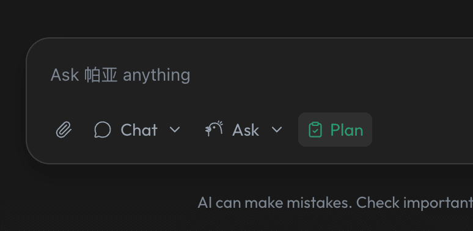

## Plan Mode · 计划小工具

A Finch mini tool that adds a **Plan Mode** button to the Composer toolbar. While it is on, your AI assistant investigates and writes a plan instead of acting, then asks you to approve it before anything changes.



<!-- TODO: shot.png 还是旧版「每轮回复后弹确认条」的界面，需要重新截图 -->

## Usage

1. Click the **Plan Mode** button (📋) in the Composer toolbar to turn planning on.
2. Send your task as usual. The assistant may read files, search, run read-only commands and browse the web — it will not write files, commit, install or send anything out.
3. When the plan is ready the assistant calls **Finish Plan** and ends its reply. A confirmation bar then appears above the composer:
   - **Execute** — turns planning off and immediately starts a new turn that carries the plan out.
   - **Continue Planning** — keeps planning mode on for another round.
4. Click the button again at any time to leave planning mode manually.

The bar only shows up on a turn where the assistant actually finished a plan, not after every planning reply. If you ignore it, planning mode stays on.

**Home page:** turning Plan Mode on at home applies to the next message only — the conversation it opens starts in planning mode.

## Install

```bash
npx @finchtoys/minitools add @finchtoys/plan-mode
```

---

为 Finch 对话添加**计划模式**按钮。开启后，AI 助手只做只读调查、输出方案，不会改动任何东西，等你批准后才动手。

## 使用方法

1. 点击对话小工具栏中的**计划模式**按钮（📋）开启。
2. 像往常一样发送任务。助手可以读文件、检索、跑只读命令、查资料，但不会写文件、提交、安装或对外发送任何东西。
3. 方案写完，助手会调用**完成计划**并结束本轮回复，随后输入框上方出现确认条：
   - **执行** — 关闭计划模式，直接发出下一轮，按计划开始动手。
   - **继续计划** — 保持计划模式，再来一轮。
4. 随时再次点击按钮手动退出计划模式。

确认条只在助手真正写完方案的轮次出现，不是每轮计划后都弹。不理它的话，计划模式会一直保持开启。

**首页：** 在首页开启计划模式，仅对下一条消息生效，发送后自动进入新对话并保持计划模式。

## 安装

```bash
npx @finchtoys/minitools add @finchtoys/plan-mode
```
